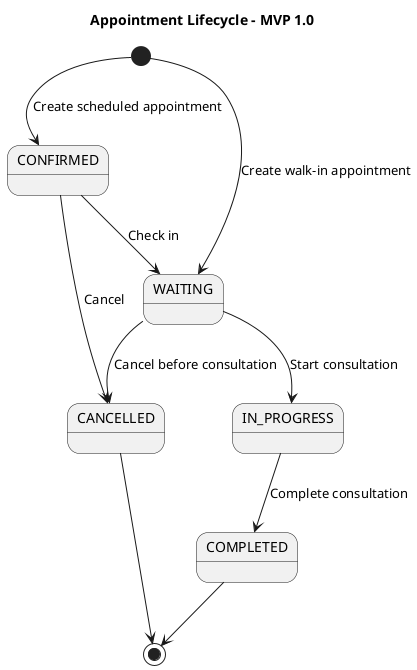

# Appointment Lifecycle Specification

## 1. Scope

This specification defines the appointment lifecycle for Clinic Management System MVP 1.0.

Doctor work schedules, leave periods, and automatic doctor availability calculation are outside the scope of this lifecycle.

## 2. Appointment Statuses

| Status | Meaning |
|---|---|
| `CONFIRMED` | Appointment has been created for a future time. Patient has not checked in. |
| `WAITING` | Patient has checked in and is waiting for the assigned doctor. |
| `IN_PROGRESS` | Doctor has started the consultation. |
| `COMPLETED` | Consultation has been completed. |
| `CANCELLED` | Appointment has been cancelled while in `CONFIRMED` or `WAITING`. |

## 3. Initial Status Rules

| Intake Type | Initial Status |
|---|---|
| Scheduled appointment | `CONFIRMED` |
| Walk-in patient | `WAITING` |

## 4. Allowed Transitions

```text
CONFIRMED  → WAITING
CONFIRMED  → CANCELLED
WAITING    → IN_PROGRESS
WAITING    → CANCELLED
IN_PROGRESS → COMPLETED
```

## 5. Forbidden Transitions

```text
CONFIRMED   → COMPLETED
CONFIRMED   → IN_PROGRESS
WAITING     → CONFIRMED
WAITING     → COMPLETED
IN_PROGRESS → WAITING
IN_PROGRESS → CANCELLED
COMPLETED   → any status
CANCELLED   → any status
```

`COMPLETED` and `CANCELLED` are terminal statuses.

## 6. Transition Events

| Event | Current Status | New Status | Actor |
|---|---|---|---|
| Check in patient | `CONFIRMED` | `WAITING` | Receptionist |
| Start consultation | `WAITING` | `IN_PROGRESS` | Assigned doctor |
| Complete consultation | `IN_PROGRESS` | `COMPLETED` | Assigned doctor |
| Cancel scheduled appointment | `CONFIRMED` | `CANCELLED` | Receptionist |
| Cancel checked-in appointment | `WAITING` | `CANCELLED` | Receptionist |

## 7. Transition Data

### 7.1 Check-in

The system shall persist:

```text
checked_in_at
checked_in_by
```

### 7.2 Start Consultation

The system shall persist:

```text
consultation_started_at
consultation_started_by
```

### 7.3 Complete Consultation

The system shall persist:

```text
completed_at
completed_by
```

### 7.4 Cancel Appointment

The system shall persist:

```text
cancelled_at
cancelled_by
cancellation_reason
```

`cancellation_reason` is mandatory.

## 8. Concurrency Rule

A doctor may have at most one appointment in `IN_PROGRESS` at any time.

The rule must be enforced by:

1. Backend service validation.
2. Database constraint where supported.
3. Transactional locking when starting a consultation.

Suggested PostgreSQL constraint:

```python
models.UniqueConstraint(
    fields=["doctor"],
    condition=models.Q(status="IN_PROGRESS"),
    name="unique_in_progress_appointment_per_doctor",
)
```

## 9. State Mutation Rules

Appointment status must not be updated through a generic status field update endpoint.

Required business actions:

```http
POST /appointments/{id}/check-in
POST /appointments/{id}/start-consultation
POST /appointments/{id}/complete
POST /appointments/{id}/cancel
```

Each action must:

1. Validate the current status.
2. Validate the actor's permission.
3. Lock the appointment row during mutation.
4. Persist transition timestamps and actor fields.
5. Write an appointment status history record.
6. Commit all related changes atomically.

## 10. Status History

Each status transition must create a history record containing:

```text
appointment_id
from_status
to_status
changed_by
changed_at
reason
```

`reason` is required for cancellation transitions.

## 11. Activity Diagram




## 12. Scheduling Independence

Appointment state transitions are independent of doctor work-schedule configuration.

MVP 1.0 does not contain:

```text
DoctorSchedule
DoctorScheduleException
automatic doctor availability verification
automatic slot generation from doctor working hours
```

The receptionist is responsible for confirming that the doctor can receive a scheduled appointment.

The backend remains responsible for preventing overlapping appointments for the same doctor.
