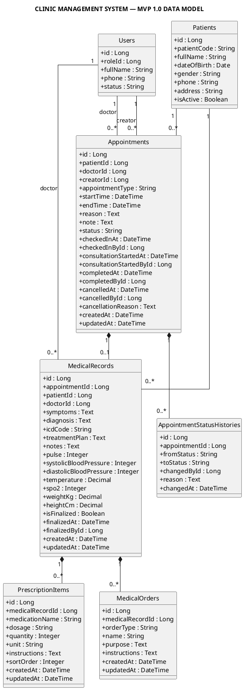

# Django Data Model Specification — Clinic Management System MVP 1.0

## 1. Document Scope

This specification defines the Django data model for appointment scheduling, patient consultation, medical records, prescriptions, medical orders, status history, validation, constraints, deletion behavior, and transaction requirements for MVP 1.0.

The specification excludes doctor work schedules and schedule exceptions.

---

## 2. MVP Entities

The MVP data model contains the following entities:

```text
Patient
User
Appointment
AppointmentStatusHistory
MedicalRecord
PrescriptionItem
MedicalOrder
```

Out of scope:

```text
DoctorSchedule
DoctorScheduleException
Medication catalog
Inventory
Billing
Lab result workflow
Imaging result workflow
Online patient booking
Automatic doctor availability calculation
```

---

## 3. Appointment Lifecycle

### 3.1 Status Enum

```python
class Status(models.TextChoices):
    CONFIRMED = "CONFIRMED", "Confirmed"
    WAITING = "WAITING", "Waiting"
    IN_PROGRESS = "IN_PROGRESS", "In progress"
    COMPLETED = "COMPLETED", "Completed"
    CANCELLED = "CANCELLED", "Cancelled"
```

### 3.2 Allowed Transitions

```text
CONFIRMED   → WAITING
CONFIRMED   → CANCELLED
WAITING     → IN_PROGRESS
WAITING     → CANCELLED
IN_PROGRESS → COMPLETED
```

### 3.3 Forbidden Transitions

```text
CONFIRMED   → IN_PROGRESS
CONFIRMED   → COMPLETED
WAITING     → CONFIRMED
WAITING     → COMPLETED
IN_PROGRESS → WAITING
IN_PROGRESS → CANCELLED
COMPLETED   → any status
CANCELLED   → any status
```

`COMPLETED` and `CANCELLED` are terminal statuses.

### 3.4 Appointment Type Enum

```python
class AppointmentType(models.TextChoices):
    SCHEDULED = "SCHEDULED", "Scheduled"
    WALK_IN = "WALK_IN", "Walk-in"
```

Initial status rules:

| Appointment Type | Initial Status |
|---|---|
| `SCHEDULED` | `CONFIRMED` |
| `WALK_IN` | `WAITING` |

---

## 4. Appointment Time Rules

### 4.1 Scheduled Appointment

A scheduled appointment must contain:

```text
start_time
end_time
```

Validation:

```text
end_time > start_time
```

Default duration:

```text
30 minutes
```

### 4.2 Walk-in Appointment

For a walk-in appointment:

```text
start_time = checked_in_at
end_time = start_time + 30 minutes
status = WAITING
```

### 4.3 Planned vs Actual Time

Planned time:

```text
start_time
end_time
```

Operational time:

```text
checked_in_at
consultation_started_at
completed_at
```

Operational timestamps must not modify planned time.

The system must not:

- Extend calendar blocks automatically.
- Shorten calendar blocks automatically.
- Move later appointments automatically.
- Reopen unused planned time automatically.

---

## 5. Appointment Model

```python
from django.conf import settings
from django.core.exceptions import ValidationError
from django.db import models
from django.db.models import F, Q

from patient_service.models import Patient


class Appointment(models.Model):
    class Status(models.TextChoices):
        CONFIRMED = "CONFIRMED", "Confirmed"
        WAITING = "WAITING", "Waiting"
        IN_PROGRESS = "IN_PROGRESS", "In progress"
        COMPLETED = "COMPLETED", "Completed"
        CANCELLED = "CANCELLED", "Cancelled"

    class AppointmentType(models.TextChoices):
        SCHEDULED = "SCHEDULED", "Scheduled"
        WALK_IN = "WALK_IN", "Walk-in"

    patient = models.ForeignKey(
        Patient,
        on_delete=models.PROTECT,
        related_name="appointments",
    )

    doctor = models.ForeignKey(
        settings.AUTH_USER_MODEL,
        on_delete=models.PROTECT,
        related_name="doctor_appointments",
    )

    creator = models.ForeignKey(
        settings.AUTH_USER_MODEL,
        on_delete=models.PROTECT,
        related_name="created_appointments",
    )

    appointment_type = models.CharField(
        max_length=20,
        choices=AppointmentType.choices,
    )

    start_time = models.DateTimeField()
    end_time = models.DateTimeField()

    reason = models.TextField()
    note = models.TextField(blank=True)

    status = models.CharField(
        max_length=20,
        choices=Status.choices,
        db_index=True,
    )

    checked_in_at = models.DateTimeField(
        null=True,
        blank=True,
    )

    checked_in_by = models.ForeignKey(
        settings.AUTH_USER_MODEL,
        on_delete=models.PROTECT,
        related_name="checked_in_appointments",
        null=True,
        blank=True,
    )

    consultation_started_at = models.DateTimeField(
        null=True,
        blank=True,
    )

    consultation_started_by = models.ForeignKey(
        settings.AUTH_USER_MODEL,
        on_delete=models.PROTECT,
        related_name="started_consultations",
        null=True,
        blank=True,
    )

    completed_at = models.DateTimeField(
        null=True,
        blank=True,
    )

    completed_by = models.ForeignKey(
        settings.AUTH_USER_MODEL,
        on_delete=models.PROTECT,
        related_name="completed_appointments",
        null=True,
        blank=True,
    )

    cancelled_at = models.DateTimeField(
        null=True,
        blank=True,
    )

    cancelled_by = models.ForeignKey(
        settings.AUTH_USER_MODEL,
        on_delete=models.PROTECT,
        related_name="cancelled_appointments",
        null=True,
        blank=True,
    )

    cancellation_reason = models.TextField(blank=True)

    created_at = models.DateTimeField(auto_now_add=True)
    updated_at = models.DateTimeField(auto_now=True)

    class Meta:
        ordering = ["start_time", "id"]

        indexes = [
            models.Index(
                fields=["doctor", "start_time"],
                name="appt_doctor_start_idx",
            ),
            models.Index(
                fields=["doctor", "status", "checked_in_at"],
                name="appt_doctor_queue_idx",
            ),
            models.Index(
                fields=["patient", "-created_at"],
                name="appt_patient_history_idx",
            ),
            models.Index(
                fields=["status", "start_time"],
                name="appt_status_start_idx",
            ),
        ]

        constraints = [
            models.CheckConstraint(
                condition=Q(end_time__gt=F("start_time")),
                name="appointment_end_after_start",
            ),
            models.UniqueConstraint(
                fields=["doctor"],
                condition=Q(status="IN_PROGRESS"),
                name="unique_in_progress_appointment_per_doctor",
            ),
        ]

    def clean(self):
        super().clean()

        errors = {}

        if self.appointment_type == self.AppointmentType.SCHEDULED:
            if self.status not in {
                self.Status.CONFIRMED,
                self.Status.WAITING,
                self.Status.IN_PROGRESS,
                self.Status.COMPLETED,
                self.Status.CANCELLED,
            }:
                errors["status"] = "Invalid status for scheduled appointment."

        if self.appointment_type == self.AppointmentType.WALK_IN:
            if self.status not in {
                self.Status.WAITING,
                self.Status.IN_PROGRESS,
                self.Status.COMPLETED,
                self.Status.CANCELLED,
            }:
                errors["status"] = (
                    "Walk-in appointment must start from WAITING."
                )

            if not self.checked_in_at:
                errors["checked_in_at"] = (
                    "Walk-in appointment requires checked_in_at."
                )

        if self.status in {
            self.Status.WAITING,
            self.Status.IN_PROGRESS,
            self.Status.COMPLETED,
        } and not self.checked_in_at:
            errors["checked_in_at"] = (
                "Checked-in timestamp is required for this status."
            )

        if self.status == self.Status.IN_PROGRESS:
            if not self.consultation_started_at:
                errors["consultation_started_at"] = (
                    "IN_PROGRESS appointment requires consultation_started_at."
                )

            if not self.consultation_started_by_id:
                errors["consultation_started_by"] = (
                    "IN_PROGRESS appointment requires consultation_started_by."
                )

        if self.status == self.Status.COMPLETED:
            if not self.completed_at:
                errors["completed_at"] = (
                    "COMPLETED appointment requires completed_at."
                )

            if not self.completed_by_id:
                errors["completed_by"] = (
                    "COMPLETED appointment requires completed_by."
                )

        if self.status == self.Status.CANCELLED:
            if not self.cancelled_at:
                errors["cancelled_at"] = (
                    "CANCELLED appointment requires cancelled_at."
                )

            if not self.cancelled_by_id:
                errors["cancelled_by"] = (
                    "CANCELLED appointment requires cancelled_by."
                )

            if not self.cancellation_reason.strip():
                errors["cancellation_reason"] = (
                    "Cancellation reason is required."
                )

        if errors:
            raise ValidationError(errors)

    def __str__(self):
        return (
            f"Appointment #{self.pk} - "
            f"{self.patient} - "
            f"{self.start_time:%d/%m/%Y %H:%M}"
        )
```

---

## 6. Appointment Overlap Rules

### 6.1 Conflict Formula

Two appointments overlap when:

```text
existing.start_time < new.end_time
AND
existing.end_time > new.start_time
```

### 6.2 Conflict Scope

The overlap check applies to appointments for the same doctor with status:

```text
CONFIRMED
WAITING
IN_PROGRESS
COMPLETED
```

Appointments with status `CANCELLED` do not block time.

### 6.3 Required Backend Validation

```python
conflicting = Appointment.objects.filter(
    doctor_id=doctor_id,
    status__in=[
        Appointment.Status.CONFIRMED,
        Appointment.Status.WAITING,
        Appointment.Status.IN_PROGRESS,
        Appointment.Status.COMPLETED,
    ],
    start_time__lt=end_time,
    end_time__gt=start_time,
)

if appointment_id is not None:
    conflicting = conflicting.exclude(pk=appointment_id)

if conflicting.exists():
    raise ValidationError({
        "time": "The selected period overlaps another appointment."
    })
```

### 6.4 Concurrency

Overlap validation must run inside `transaction.atomic()`.

`Model.clean()` is not sufficient as the only concurrency protection.

---

## 7. Doctor Availability Scope

MVP 1.0 does not persist doctor work schedules.

The system does not verify:

```text
doctor working days
doctor working shifts
doctor leave
doctor schedule exceptions
overtime availability
```

The receptionist is responsible for confirming that the doctor can receive the appointment.

An empty calendar period means only:

```text
No conflicting appointment is stored in the system.
```

It does not guarantee doctor availability.

---

## 8. Appointment Status History Model

```python
class AppointmentStatusHistory(models.Model):
    appointment = models.ForeignKey(
        Appointment,
        on_delete=models.CASCADE,
        related_name="status_history",
    )

    from_status = models.CharField(
        max_length=20,
        choices=Appointment.Status.choices,
        blank=True,
    )

    to_status = models.CharField(
        max_length=20,
        choices=Appointment.Status.choices,
    )

    changed_by = models.ForeignKey(
        settings.AUTH_USER_MODEL,
        on_delete=models.PROTECT,
        related_name="appointment_status_changes",
    )

    reason = models.TextField(blank=True)
    changed_at = models.DateTimeField(auto_now_add=True)

    class Meta:
        ordering = ["changed_at", "id"]
        indexes = [
            models.Index(
                fields=["appointment", "changed_at"],
                name="appt_history_time_idx",
            ),
        ]

    def clean(self):
        super().clean()

        if (
            self.to_status == Appointment.Status.CANCELLED
            and not self.reason.strip()
        ):
            raise ValidationError({
                "reason": "Cancellation transition requires a reason."
            })
```

Each successful transition must create exactly one history record.

---

## 9. Medical Record Model

### 9.1 Relationship

`MedicalRecord` stores direct references to:

```text
appointment
patient
doctor
```

Duplicated patient and doctor references are accepted for MVP 1.0.

Consistency rule:

```text
medical_record.patient_id = medical_record.appointment.patient_id
medical_record.doctor_id = medical_record.appointment.doctor_id
```

### 9.2 Required Completion Fields

Required when finalizing:

```text
symptoms
diagnosis
```

### 9.3 Optional Fields

All vital-sign fields are optional:

```text
pulse
systolic_blood_pressure
diastolic_blood_pressure
temperature
spo2
weight_kg
height_cm
```

### 9.4 Django Model

```python
class MedicalRecord(models.Model):
    appointment = models.OneToOneField(
        Appointment,
        on_delete=models.PROTECT,
        related_name="medical_record",
    )

    patient = models.ForeignKey(
        Patient,
        on_delete=models.PROTECT,
        related_name="medical_records",
    )

    doctor = models.ForeignKey(
        settings.AUTH_USER_MODEL,
        on_delete=models.PROTECT,
        related_name="medical_records",
    )

    symptoms = models.TextField(blank=True)
    diagnosis = models.TextField(blank=True)

    icd_code = models.CharField(
        max_length=20,
        blank=True,
    )

    treatment_plan = models.TextField(blank=True)
    notes = models.TextField(blank=True)

    pulse = models.PositiveSmallIntegerField(
        null=True,
        blank=True,
    )

    systolic_blood_pressure = models.PositiveSmallIntegerField(
        null=True,
        blank=True,
    )

    diastolic_blood_pressure = models.PositiveSmallIntegerField(
        null=True,
        blank=True,
    )

    temperature = models.DecimalField(
        max_digits=4,
        decimal_places=1,
        null=True,
        blank=True,
    )

    spo2 = models.PositiveSmallIntegerField(
        null=True,
        blank=True,
    )

    weight_kg = models.DecimalField(
        max_digits=5,
        decimal_places=2,
        null=True,
        blank=True,
    )

    height_cm = models.DecimalField(
        max_digits=5,
        decimal_places=1,
        null=True,
        blank=True,
    )

    is_finalized = models.BooleanField(
        default=False,
        db_index=True,
    )

    finalized_at = models.DateTimeField(
        null=True,
        blank=True,
    )

    finalized_by = models.ForeignKey(
        settings.AUTH_USER_MODEL,
        on_delete=models.PROTECT,
        related_name="finalized_medical_records",
        null=True,
        blank=True,
    )

    created_at = models.DateTimeField(auto_now_add=True)
    updated_at = models.DateTimeField(auto_now=True)

    class Meta:
        indexes = [
            models.Index(
                fields=["patient", "-created_at"],
                name="medical_patient_history_idx",
            ),
            models.Index(
                fields=["doctor", "-created_at"],
                name="medical_doctor_history_idx",
            ),
        ]

    def clean(self):
        super().clean()

        errors = {}

        if self.appointment_id:
            if self.patient_id != self.appointment.patient_id:
                errors["patient"] = (
                    "Patient must match appointment patient."
                )

            if self.doctor_id != self.appointment.doctor_id:
                errors["doctor"] = (
                    "Doctor must match appointment doctor."
                )

        if self.is_finalized:
            if not self.symptoms.strip():
                errors["symptoms"] = "Symptoms are required."

            if not self.diagnosis.strip():
                errors["diagnosis"] = "Diagnosis is required."

            if not self.finalized_at:
                errors["finalized_at"] = (
                    "Finalized record requires finalized_at."
                )

            if not self.finalized_by_id:
                errors["finalized_by"] = (
                    "Finalized record requires finalized_by."
                )

        if errors:
            raise ValidationError(errors)

    def __str__(self):
        return f"Medical Record #{self.pk}"
```

---

## 10. Prescription Item Model

Prescription items are linked directly to `MedicalRecord`.

No intermediate `Prescription` model is required in MVP 1.0.

```python
class PrescriptionItem(models.Model):
    medical_record = models.ForeignKey(
        MedicalRecord,
        on_delete=models.CASCADE,
        related_name="prescription_items",
    )

    medication_name = models.CharField(max_length=255)
    dosage = models.CharField(max_length=100)
    quantity = models.PositiveIntegerField()

    unit = models.CharField(
        max_length=50,
        blank=True,
    )

    instructions = models.TextField()
    sort_order = models.PositiveIntegerField(default=0)

    created_at = models.DateTimeField(auto_now_add=True)
    updated_at = models.DateTimeField(auto_now=True)

    class Meta:
        ordering = ["sort_order", "id"]

    def __str__(self):
        return self.medication_name
```

A medication catalog and inventory reference are out of scope.

---

## 11. Medical Order Model

```python
class MedicalOrder(models.Model):
    class OrderType(models.TextChoices):
        LAB_TEST = "LAB_TEST", "Lab test"
        IMAGING = "IMAGING", "Imaging"
        PROCEDURE = "PROCEDURE", "Procedure"
        OTHER = "OTHER", "Other"

    medical_record = models.ForeignKey(
        MedicalRecord,
        on_delete=models.CASCADE,
        related_name="medical_orders",
    )

    order_type = models.CharField(
        max_length=20,
        choices=OrderType.choices,
    )

    name = models.CharField(max_length=255)
    purpose = models.TextField(blank=True)
    instructions = models.TextField(blank=True)

    created_at = models.DateTimeField(auto_now_add=True)
    updated_at = models.DateTimeField(auto_now=True)

    class Meta:
        ordering = ["created_at", "id"]

    def __str__(self):
        return self.name
```

Execution status, results, billing, and external laboratory integration are out of scope.

---

## 12. Deletion Rules

| Relationship | `on_delete` |
|---|---|
| Patient → Appointment | `PROTECT` |
| Doctor/User → Appointment | `PROTECT` |
| Creator/User → Appointment | `PROTECT` |
| Appointment → MedicalRecord | `PROTECT` |
| Patient → MedicalRecord | `PROTECT` |
| Doctor/User → MedicalRecord | `PROTECT` |
| MedicalRecord → PrescriptionItem | `CASCADE` |
| MedicalRecord → MedicalOrder | `CASCADE` |
| Appointment → AppointmentStatusHistory | `CASCADE` |
| User → AppointmentStatusHistory | `PROTECT` |

Patient and user records referenced by clinical data must not be physically deleted.

MVP may use an `is_active` field for deactivation.

---

## 13. PostgreSQL Constraints

MVP 1.0 uses PostgreSQL.

Required database-level constraint:

```python
models.UniqueConstraint(
    fields=["doctor"],
    condition=Q(status="IN_PROGRESS"),
    name="unique_in_progress_appointment_per_doctor",
)
```

Required check constraint:

```python
models.CheckConstraint(
    condition=Q(end_time__gt=F("start_time")),
    name="appointment_end_after_start",
)
```

Appointment overlap protection remains mandatory in the service layer.

A PostgreSQL `ExclusionConstraint` may be added after MVP if database-enforced range overlap protection is required.

---

## 14. Business Service Requirements

Required service operations:

```text
create_scheduled_appointment
create_walk_in_appointment
update_confirmed_appointment
check_in_appointment
start_consultation
save_medical_record_draft
complete_consultation
cancel_appointment
```

Status must not be changed through a generic update endpoint.

### 14.1 API Actions

```http
POST /appointments
POST /appointments/walk-in
PATCH /appointments/{id}
POST /appointments/{id}/check-in
POST /appointments/{id}/start-consultation
POST /appointments/{id}/complete
POST /appointments/{id}/cancel
```

`PATCH /appointments/{id}` may edit only `CONFIRMED` appointment scheduling data and must not accept direct status mutation.

---

## 15. Transaction Requirements

The following operations must use `transaction.atomic()` and `select_for_update()` where applicable:

```text
create scheduled appointment
update confirmed appointment time
check in
start consultation
complete consultation
cancel appointment
```

### 15.1 Complete Consultation Transaction

The completion transaction must atomically:

1. Validate appointment status is `IN_PROGRESS`.
2. Validate current doctor owns the appointment.
3. Validate `symptoms`.
4. Validate `diagnosis`.
5. Save `MedicalRecord`.
6. Save `PrescriptionItem` records.
7. Save `MedicalOrder` records.
8. Set `MedicalRecord.is_finalized = True`.
9. Set finalization metadata.
10. Set appointment status to `COMPLETED`.
11. Set completion metadata.
12. Create status history.

Failure of any step must roll back all writes.

---

## 16. Status Transition Service Rules

```python
ALLOWED_TRANSITIONS = {
    Appointment.Status.CONFIRMED: {
        Appointment.Status.WAITING,
        Appointment.Status.CANCELLED,
    },
    Appointment.Status.WAITING: {
        Appointment.Status.IN_PROGRESS,
        Appointment.Status.CANCELLED,
    },
    Appointment.Status.IN_PROGRESS: {
        Appointment.Status.COMPLETED,
    },
    Appointment.Status.COMPLETED: set(),
    Appointment.Status.CANCELLED: set(),
}
```

The backend must validate transitions before mutation.

---

## 17. Class Diagram



---

## 18. Migration Requirements

The migration from the existing model must:

1. Add `IN_PROGRESS` to appointment statuses.
2. Replace `appointment_time` with `start_time` and `end_time`.
3. Add `appointment_type`.
4. Add check-in metadata.
5. Add consultation start metadata.
6. Add completion metadata.
7. Add cancellation metadata.
8. Add appointment indexes and constraints.
9. Add `AppointmentStatusHistory`.
10. Add direct `patient` and `doctor` fields to `MedicalRecord`.
11. Add vital-sign fields.
12. Add medical record finalization fields.
13. Add `PrescriptionItem`.
14. Add `MedicalOrder`.
15. Migrate existing appointment data before enforcing non-null constraints.

Existing data migration rules must be defined per environment before deployment.

---

## 19. MVP Exclusions

MVP 1.0 does not include:

```text
DoctorSchedule
DoctorScheduleException
Automatic slot generation
Automatic doctor availability verification
Automatic delay calculation
Automatic rescheduling
Automatic reopening of early-finished slots
Online patient self-booking
Medication inventory
Billing
Laboratory result workflow
Imaging result workflow
Cancellation from IN_PROGRESS
Multiple simultaneous IN_PROGRESS appointments per doctor
```
